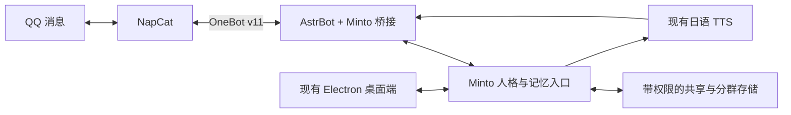

# Minto Assistant：QQ 接入可行性与需求方案

调研日期：2026-10-25。基线：本地 0.5.5 源码。

本文交付需求分析与实施建议。本次未安装机器人组件、登录 QQ、读取群消息或修改日常存档。下面标为“建议”的设计、参数与验收目标尚未实现，不能作为实机兼容结论。外部能力依据项目文档、许可证、部分配置文件和记忆检索源码核对，正式开发前需锁定版本并做协议样本测试。

## 1. 结论与范围

整体可行。推荐组合是：外部 QQ 协议端 NapCat、AstrBot 消息框架、自建 Minto 桥接插件，以及桌面与 QQ 共用的 Minto 人格和记忆入口。

OneBot 是协议规范，不承担 QQ 登录。接管普通 QQ 账号，需要另外运行协议端。账号的可操作范围受 QQ 实际权限、协议端能力与登录状态限制，不能等同于任意群管理权限，也不能承诺没有账号风控或长期协议兼容问题。[OneBot 规范](https://github.com/botuniverse/onebot-11)、[AstrBot 接入文档](https://docs.astrbot.app/platform/aiocqhttp.html)。

建议给薄荷使用独立 QQ 账号；固定把 2992576898 识别为主人。登录账号与主人账号分开，避免自发自收和身份冲突。机器人 QQ 号尚未指定。

“管理一整个 QQ 账号”建议拆为：登录状态、好友/群列表、消息收发与查询、邀请/好友请求处理、资料/备注管理。踢人、禁言、退群、删除好友等另列为人工管理操作，是否可执行先检查账号实际权限。首版完整呈现账号和会话，优先打通消息与记忆，不让对话模型自行处理这些管理操作。[NapCat 接口兼容表](https://napneko.github.io/develop/api)。

## 2. 框架与协议选择

| 路线 | 对本项目的价值 | 代价与边界 | 建议 |
| --- | --- | --- | --- |
| NapCat + OneBot v11 + AstrBot | 普通 QQ 账号接入；复用消息、插件和媒体链路 | 多一个 Python 框架进程；需维护桥接与依赖版本 | 首选 |
| NapCat + OneBot v11 直接接入 Minto | 沿用 Node.js，运行组件更少 | 消息路由、重连、调度、管理与插件联动自行维护 | 轻量备选 |
| AstrBot + QQ 官方机器人 | 官方平台路线，框架支持文本和媒体 | 是独立机器人身份；群接入受平台规则限制，不能视为个人账号托管 | 用户放宽账号要求时考虑 |

AstrBot 已提供 OneBot v11 适配器及带权限范围的 HTTP API，能复用部分平台、模型与插件管理能力；群消息审计、20 分钟归档和本项目记忆边界仍需要专用桥接。[OneBot 接入](https://docs.astrbot.app/platform/aiocqhttp.html)、[AstrBot HTTP API](https://docs.astrbot.app/dev/openapi.html)。

QQ 官方机器人当前文档支持扫码创建、设置获取群内全部消息及主动发言；同时写明扫码创建路线目前只能加入自己为群主的群。官方身份标识与普通 QQ 数字号也不能混用。这里不能沿用“官方机器人必定收不到群全量消息”的旧判断。[官方接入文档](https://docs.astrbot.app/platform/qqofficial/websockets.html)、[身份差异说明](https://raw.githubusercontent.com/ZhaoJun233/astrbot_plugin_xiaozhao_memory/master/README.md)。

Lagrange 当前主线为 V2，V1 已结束维护，新主线提供的服务项目为 Lagrange.Milky。若选择它，应按 Milky 单独评估适配，不能把旧版 Lagrange.OneBot 教程当作当前兼容依据。[Lagrange.Core 当前说明](https://github.com/LagrangeDev/Lagrange.Core)。

许可方面，AstrBot 使用 AGPL-3.0；NapCat 的当前 LICENSE 是带限制条款的自定义许可，不能把所有公开仓库都当作可按 Apache-2.0 任意复制的代码。本项目优先通过外部进程和协议调用集成，发布前仍需核对具体组件的运行、修改及再分发条件。[AstrBot LICENSE](https://github.com/AstrBotDevs/AstrBot/blob/master/LICENSE)、[NapCat LICENSE](https://github.com/NapNeko/NapCatQQ/blob/main/LICENSE)。

## 3. AstrBot 社区插件调研

| 项目 | 已核对的能力 | 本项目采用方式 |
| --- | --- | --- |
| [group_chat_plus](https://github.com/Him666233/astrbot_plugin_group_chat_plus) | @/关键词、图片处理、合并消息、判断是否接话、回复后处理 | 借鉴群聊调度和自然接话策略；统一决定回复，避免与原框架重复发言 |
| [self_initiated_reply](https://github.com/chengzhi-c/astrbot_plugin_self_initiated_reply) | 白名单会话的主动接话，避开 @/命令重复响应，复用主回复管线 | 更小范围的主动接话参考；与上一项选择一种主调度策略 |
| [Mnemosyne](https://github.com/lxfight/astrbot_plugin_mnemosyne) | 记忆总结、向量检索、会话/人格过滤及管理界面 | 借鉴索引和召回；不让第二套数据库成为另一份主记忆 |
| [xiaozhao_memory](https://github.com/ZhaoJun233/astrbot_plugin_xiaozhao_memory) | 群/账号隔离，同时支持同一用户跨群记忆 | 跨群用户联动与本需求冲突，必须关闭或在桥接中阻断 |
| [meme_manager](https://github.com/anka-afk/astrbot_plugin_meme_manager) | 表情包收集、分类、检索、发送与管理 | 作为可选表情素材组件；是否回应仍由统一触发器决定 |

注意：Mnemosyne 文档里的 `use_session_filtering: false` 会共享会话记忆，不能用于本需求；`use_participant_filtering` 是参与者维度，也不能替代群维度隔离。xiaozhao_memory 当前配置含 `user_memory_limit`，默认 6，文档明确是跨群用户记忆；当前检索源码按该数量裁切跨群结果，设为 0 会在这一检索路径返回空结果；正式采用仍须通过双群测试覆盖所有注入入口。[Mnemosyne 配置说明](https://github.com/lxfight/astrbot_plugin_mnemosyne)、[小昭实际配置](https://raw.githubusercontent.com/ZhaoJun233/astrbot_plugin_xiaozhao_memory/master/_conf_schema.json)、[记忆检索源码](https://raw.githubusercontent.com/ZhaoJun233/astrbot_plugin_xiaozhao_memory/master/memory_store.py)。

这些插件的 README、配置与许可证并非都同步，正式复用以选定提交的源文件和 LICENSE 为准。调研未对插件做完整安全审计或运行验收。

## 4. 与现有 0.5.5 的结合方式

本地源码确认：

- `services/assistant-service.js` 统一生成提示词，并强制日语正文；不能原样用于 QQ 中文输出。
- `services/relationship-service.js` 当前把对话用户作为恋人/主人；QQ 端必须先按真实发送者区分身份。
- `services/save-store.js` 使用每存档 JSON，含对话、摘要与好感；不是为多群并发写入设计的数据库。
- `services/voice-service.js` 使用日语合成，并校验 WAV 音频，可复用现有角色声线。
- `services/agent-service.js` 含本地文件、命令及 MCP 工具。群友消息不应直接进入这套桌面执行权限。

建议结构：

AstrBot 负责事件与消息发送，Minto 负责身份、人格、记忆和最终回复。桥接处理完成后停止框架的默认回复流程，确保一条消息只有一个回复责任方。社区插件先按能力选择，不叠加多套自动回复或记忆注入器。

首版可让 Electron 主进程托管本地接口，程序退出后 QQ AI 也停止；关闭角色窗口但保留托盘时继续运行。若要退出桌面程序仍全天在线，再把该入口独立成后台服务。不要先整体迁移桌面技术栈。

本地桥接接口绑定回环地址并鉴权；AstrBot 使用独立环境，不把它装入当前 Style-Bert-VITS2 的 Python 环境。

## 5. 唯一主人的身份规则

1. OneBot 消息按真实事件的 `user_id` 识别发送人，只有 2992576898 对应主人；`self_id` 是机器人自身。匿名消息不授予主人身份。
2. 昵称、群名片、引用、转发、截图和“我是主人”的正文都不能替代真实发送者标识。
3. 对普通群友保留同一个薄荷人格，但不用恋人待遇称呼每个人为マスター。主人不在场时也不能把当前聊天者自动当成主人。
4. 主人的好感与关系跨桌面、主人 QQ 私聊共用；普通群友的发言不增减该好感。主人在群内互动是否计分作为设置项，跨端共用每日上限和去重记录。
5. 普通群友只能使用聊天、当前群记忆、图片理解和受控语音。账号管理在桌面端执行；主人身份与本地命令执行权限分别管理。

字段依据：[OneBot 消息事件规范](https://raw.githubusercontent.com/botuniverse/onebot-11/master/event/message.md)。若以后增加 QQ 官方机器人适配，其 openid 需要可信绑定，不能直接与普通 QQ 数字号比较。

## 6. 公共记忆与群聊隔离

“公共”建议表示统一存储和统一人格；每份记忆仍有读取范围。若把所有群摘要直接拼进一段全局提示词，再让每群读取全部主记忆，就会破坏隔离。

| 记忆范围 | 内容 | 群聊可读取范围 |
| --- | --- | --- |
| 共同人格 | 薄荷设定、说话方式、主人身份规则、公共行为偏好 | 已启用群可读 |
| 主人私密记忆 | 桌面聊天、主人私聊、亲密经历、个人偏好与关系状态 | 默认不向群公开；明确标为可分享的事实例外 |
| 群 A 记忆 | 群 A 的聊天、成员在该群的偏好、约定、摘要 | 群 A 可读；群 B 不可读 |
| 群 B 记忆 | 同上，属于群 B | 群 B 可读；群 A 不可读 |
| 全局索引目录 | 指向各群摘要、原消息范围与更新时间 | 桌面主人可查全部；每群只能查自己的索引 |

群记忆的隔离维度建议为：明确绑定的 Minto 人格/存档、平台实例、机器人账号、群号。群内的人物事实再绑定真实用户标识。同一个人在两个群出现，也不自动把其在另一群的话带过来。

必须先按权限和群范围过滤，再进行关键词/向量检索及重排。所有召回入口、摘要入口和发送前检查使用相同范围；不能先检索全库，再靠提示词要求模型保密。

QQ 账号需绑定明确的一份 Minto 主存档，不能随桌面当前选中存档悄悄切换。切换绑定属于显式操作，需要暂停在途请求并重新加载对应人格与记忆。

### 每 20 分钟归档

- 每条在线消息及时落库；20 分钟是摘要/索引更新周期，不是原始记录保存周期。
- 只处理有新增消息的启用群，各群单独生成增量摘要与事实索引。
- 摘要保存原消息引用范围、时间、真实发言人、所属群、版本和读取权限。
- 主记忆目录收到的是带群范围的条目与索引；群专属条目继续保持群专属，不能因归档变成全局可读。
- 通过消息游标、事务和幂等写入处理重启、失败重试与任务重入。无变化的群不重复调用模型。
- 删除或纠正记忆时，同时处理原记录可见性、摘要、索引、向量与缓存，避免下一次归档把它重新提取回来。

建议单一记忆入口持有数据库写权限，使用 SQLite WAL 和事务起步。保留并备份现有 JSON 存档，经过副本迁移与逐档校验后再接入；禁止桌面和 AstrBot 同时直接改写同一 JSON 文件。

## 7. 上下文压缩与连贯性

建议保存完整可追溯记录，模型每次只接收按当前问题选出的上下文。摘要是导航，精确数字、日期、承诺及引用关系需要能回查原文。不能承诺有损压缩后仍百分之百记住所有细节。

初始输入预算建议约 12000 tokens：人格与身份约 1500、获准共享事实约 1500、当前群摘要约 2500、近期原话及引用链约 5000、检索片段约 1500。输出另留预算。以上是待测起点，不是已验证参数，也不是模型上下文越大就应全部用满。

处理策略：

1. 近期原话与当前引用链优先保留，包含发言人和时间，不把群友全部合成一个“user”。
2. 旧消息按话题和时间段压缩，保留主体、事件、约定、未完成事项和明确纠正。
3. 历史召回先限制群与权限，再结合关键词、语义与时间；初版可先实现中文关键词与精确用户/消息查询，之后增加向量召回。
4. 同一群用串行队列处理，合并短时间连续消息；不同群并发但限制全局模型和 TTS 并发数。
5. 模型生成期间若出现改变语义的新消息，发送前重新核对上下文版本，避免发出已经过时的回答。
6. 超出预算、摘要失败或模型不可用时保留原文与最后一次成功摘要；不把空摘要写回，也不补造“共同经历”。

研究依据：Generative Agents 展示了原始经历、反思与动态检索的分层结构；LongMemEval 将信息提取、跨会话推理、时间推理、知识更新和不知道时的克制分别评估。这里借鉴其设计与验收维度，不把论文结果当作本项目效果保证。[Generative Agents](https://arxiv.org/abs/2304.03442)、[LongMemEval](https://arxiv.org/abs/2410.10813)。

AstrBot 自带上下文压缩也明确说明摘要会遗漏细节；它可协助框架上下文管理，但不替代跨桌面与 QQ 的统一长期记忆。[AstrBot 压缩文档](https://docs.astrbot.app/use/context-compress.html)。

## 8. 群聊触发与自然回复

建议先用允许列表启用少数测试群，管理界面仍显示整个账号的群列表。正式启用后，每群分别设置触发与记忆策略。

- @薄荷：强触发，结合当前群近期记录、引用链与记忆回答。
- “薄荷”“ミント”：关键词唤醒；可区分明确叫她与讨论薄荷植物，减少无关插话。
- 表情包：先做抽样和频率限制，再按图片内容与当前话题判断是否接话；抽中不等于强制回复。
- 她刚发言后别人继续同一话题：建议保留短时连续对话窗口，避免每一句都要求重新 @。
- 普通闲聊自主插话：首版可关闭，后续按群启用“是否值得插话”的轻量判断。

建议起始参数为连续消息合并 1—3 秒、连续对话窗口 60 秒、表情触发抽样 5%—10%，并设置群/用户冷却与每日预算。@、关键词、表情和连续对话命中同一条消息时只回复一次。参数需根据测试群规模实测调整。

默认输出中文，通常 1—3 个短句，必要时附一句日语；解释问题可以适度加长。避免默认标题、编号、长总结、反复提问和固定口头模板，不通过故意错字制造拟人感。回复要回应具体发言，允许在没有接话理由时保持安静。

上下文主要依靠在线事件缓存。NapCat 的 `get_group_msg_history` 可补取历史，但属于扩展能力，不能假定获得账号全部历史或所有离线消息。[NapCat 历史接口](https://napneko.github.io/onebot/api)。

消息中的图片按真实消息段处理，通过现有多模态主模型或备用视觉模型解析；表情贴图与动图不是一回事，动图先做有限帧采样。图片描述记录所属群与来源，作为观察资料，不能把图片里的指令或身份宣称当作权限。

## 9. 纯日语角色语音

中文群回复与日语口语稿分开生成；日语稿保持同一含义和语气，交给现有 Style-Bert-VITS2，验证合格后再发送语音消息。中文显示不进入当前只支持日语的角色声学模型。

TTS 与文本发送解耦：中文先发，语音排队；语音失败显示管理端错误，不重复发送文字。语音开关、触发方式、长度上限与发送频率按群设置。优先保障桌面和主人私聊，避免多个群占满合成队列。

现有语音服务输出 WAV；AstrBot 有 Record 消息组件。实际 QQ 端的编码转换、文件路径可达性与手机播放效果仍需选定协议端后实测。跨进程/容器不能假定使用相同本地文件路径。[AstrBot 消息发送](https://docs.astrbot.app/dev/star/guides/send-message.html)、[OneBot 消息段规范](https://raw.githubusercontent.com/botuniverse/onebot-11/master/message/segment.md)。

## 10. 桌面管理界面

沿用现有 UI，新增“QQ”入口，建议三栏：左侧群/私聊列表，中间消息时间线，右侧当前会话的记忆和策略。

- 账号：登录/连接状态、机器人 QQ 与主人 QQ、群和好友列表、断线及重连详情。
- 群策略：启停、@/关键词/表情触发、冷却、语音、允许读取主记忆的范围。
- 消息审计：原消息、被选中的上下文、触发原因、记忆引用、实际回复、语音、错误与发送状态。
- 人工接管：对当前群暂停 AI、编辑待发内容、手动发送、在平台允许时撤回；已发送记录保留审计。
- 记忆：当前群摘要、来源定位、纠正/删除、最近归档时间、明确标记的主记忆可分享项。

AstrBot 自带 WebUI 用于进阶管理；Minto 的日常界面通过受控本地接口呈现所需能力。不要让 Electron 渲染页面直接持有 QQ 协议端或整个 AstrBot 管理密钥。

## 11. 成本、部署与验收

每群每 20 分钟一次归档，全天持续变化时每群每天最多 72 次；10 个持续活跃群就是 720 次归档调用。实际应跳过无变化群、限制待处理消息量、为摘要/视觉/主动接话单列预算。模型费用按真实 tokens 统计，不按上下文标称容量推算。

本地 0.5.5 的 2026-10-15 验收记录中，DeepSeek 鉴权通过而生成请求超时。这是历史记录，不代表 10 月 25 日状态；接入前必须重新测普通文本、图片和群聊负载下的延迟、失败与重试。当前调研未调用用户模型接口。

建议实施顺序：

| 阶段 | 范围 | 通过条件 |
| --- | --- | --- |
| A：通路验证 | 一个机器人账号、一个测试群，@/关键词、短中文、图片、单次日语语音 | 手机真实收发；模型超时可恢复；不会重复回复 |
| B：共享与隔离 | 明确绑定主存档、双群独立记忆、20 分钟增量归档、删除/纠正 | 群 A 的独有事实不能被群 B 召回；桌面主人可查看带来源的索引 |
| C：自然互动 | 连续对话、表情抽样、节流、上下文压缩、群并发 | 话题和发言人不混淆；主人的拒绝/纠正生效；长聊不依赖全量输入 |
| D：管理交付 | 群/好友列表、时间线、人工接管、策略、打包与备份 | 日常存档及配置核对通过；升级失败可恢复 |

关键测试应包括：两个群的同一人给出不同偏好；昵称冒充主人；转发/截图里的主人身份；相同图片出现在两个群；故意要求读取另一个群；20 分钟归档重启重入；撤回和删除后的再次总结；多群同时 @；主人跨桌面与 QQ 切换；TTS 失败后不重发正文。

串群和身份识别采用零错误验收；自然度和事实回忆用固定测试对话集评估，并记录失败样例。压缩不会提供百分之百细节记忆，因此对精确事实增加来源回查和纠正流程。

实施前需要确认三项产品选择：薄荷登录的具体 QQ 账号；QQ 绑定哪一份桌面主存档；哪些主人记忆允许在群内公开。其余细节可按本文建议从小范围实测开始。
